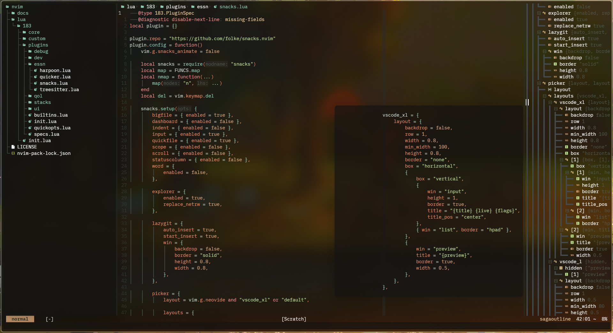

# config.nvim

configuration for neovim editor.

this time around i built this around the neovide gui for
neovim. tailored to my workflow and based on neovim and neovide nightlies (`0.13+` and
`nightly-37+`).

uses the newly built-in `vim.pack` for plugin management.

tried to be as simple and
native-first as i realistically could without sacrificing on quality of life and features.



### installation
* make sure to install neovim nightly (and optinally neovide nightly)
* clone to nvim config directory
    ```
    git clone https://github.com/anir183/config.nvim ~/.config/nvim
    ```
* install dependencies
    ```bash
    paru -S neovide-git        # use neovide nightly
    pacman -S tree-sitter-cli
    pacman -S fzf
    pacman -S ripgrep          # used for searching by several plugins
    pacman -S npm              # use in mason package installs
    ```
